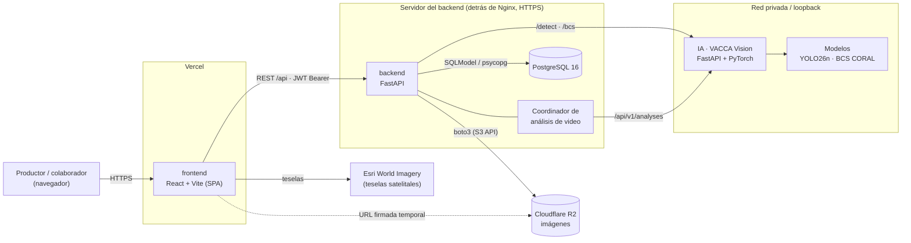
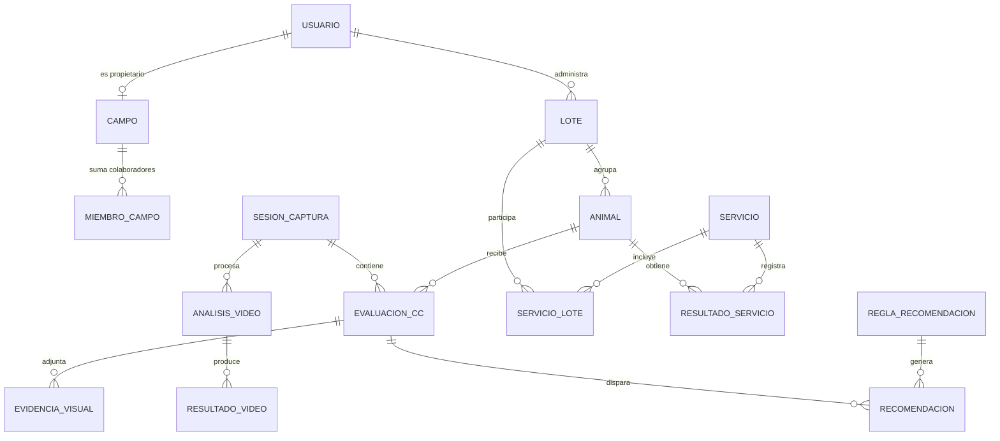
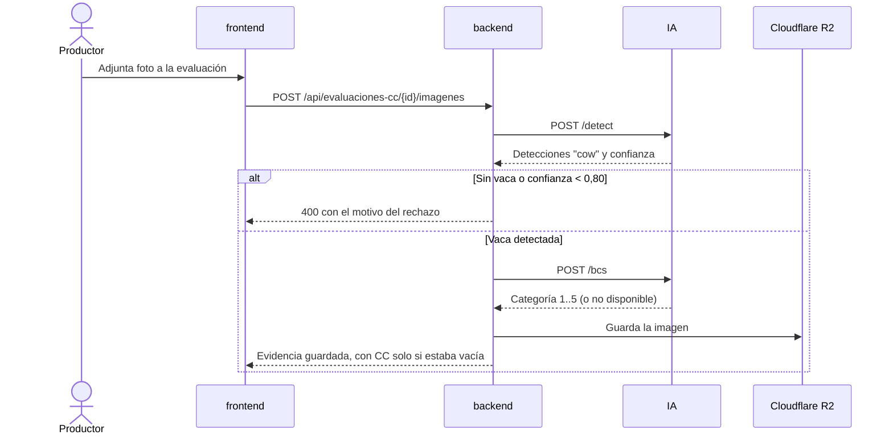

# Arquitectura de VACCA

VACCA es un sistema de soporte de decisiones para el manejo nutricional de rodeos de
cría. El productor registra su rodeo, evalúa la **condición corporal (CC)** de cada
vaca en escala 1 a 5 (a mano, con una foto o con un video de la manga) y el sistema
le devuelve tableros, alertas y recomendaciones de manejo para la temporada de servicio.

Es el **Proyecto Final de la carrera Ingeniería en Sistemas de Información** de la
**Universidad Tecnológica Nacional, Facultad Regional Resistencia (UTN FRRe)**,
desarrollado en equipo durante 2026.

Este documento describe el sistema completo. Cada repositorio tiene además su propio
README con los detalles de instalación y desarrollo.

## Repositorios

| Repositorio | Qué es | Stack principal |
| --- | --- | --- |
| [`frontend`](https://github.com/vaccautn/frontend) | Aplicación web del productor (SPA) y landing pública | React 19, TypeScript, Vite, Chakra UI, OpenLayers, Recharts |
| `backend` | API REST con la lógica de negocio, la persistencia y la integración con IA | Python 3.12, FastAPI, SQLModel, Alembic, PostgreSQL |
| [`IA`](https://github.com/vaccautn/IA) | Microservicio de visión: detección de vacas, CC desde imágenes y análisis de video | Python 3.13, FastAPI, YOLO26n (Ultralytics), PyTorch, ResNet18 + CORAL |
| [`vacca-demo`](https://github.com/vaccautn/vacca-demo) | Mockup navegable de la primera etapa, con datos simulados | React 18, Vite, Tailwind CSS |

## Vista general



Principios de la arquitectura:

- **El navegador solo habla con el backend.** El frontend nunca llama a IA ni sube
  archivos directo a R2: todo pasa por la API autenticada, que valida permisos y
  devuelve URLs firmadas de lectura con vencimiento.
- **IA es un servicio interno.** No tiene autenticación propia y debe quedar en una
  red privada o en loopback (`127.0.0.1:8001`). El backend es su único cliente.
- **El backend es la fuente de verdad.** Los modelos de IA proponen una CC; el
  backend decide cuándo se guarda y nunca pisa una CC cargada a mano.
- **Aislamiento por productor.** Cada consulta filtra por el campo y los permisos del
  usuario (`app/auth/ownership.py`), así que un productor solo ve sus lotes, animales,
  sesiones y evaluaciones; los colaboradores acceden a los campos donde fueron invitados
  y cada carga queda en el historial de actividad con su responsable.
- **Estados calculados.** El estado de un servicio (planificado, en curso, finalizado)
  se deriva de sus fechas y no se edita a mano.
- **Importación masiva con revisión.** Los CSV/XLSX pasan por una etapa de revisión
  previa; las filas con errores vuelven en un archivo aparte y la carga válida se
  registra como una tanda.

## Componentes

### Frontend (`frontend`)

SPA en React 19 + TypeScript construida con Vite y desplegada en **Vercel**
(`vercel.json` reescribe todas las rutas a `index.html`).

- **Organización por features** (`src/features/`): `auth`, `animales`, `rodeo`, `lotes`,
  `mapa`, `sesiones`, `servicios`, `recomendaciones` y `landing`. Cada feature agrupa sus
  componentes, hooks, servicios HTTP y tipos. Las páginas (`src/pages/`) solo componen
  features.
- **Ruteo** con React Router 7 y carga diferida de cada página (`src/router/`). Las rutas
  privadas pasan por `ProtectedRoute`; `/landing` es pública.
- **Cliente HTTP** único en `src/services/httpClient.ts`, que agrega el token JWT y usa
  `VITE_API_BASE_URL`.
- **UI** con Chakra UI 3, íconos Tabler, gráficos con Recharts y mapas con OpenLayers
  (potreros importados desde KMZ con JSZip).
- **Tests** unitarios y de componentes con Vitest + Testing Library, y end-to-end con
  Playwright.

### Backend (`backend`)

API REST en FastAPI. Todas las rutas de negocio cuelgan de `/api` y exigen
`Authorization: Bearer <token>`.

```text
app/
├── main.py        # App, middlewares (CORS, hosts, proxy HTTPS, límite de video) y routers
├── config.py      # Configuración por variables de entorno (pydantic-settings)
├── database.py    # Motor y sesión de SQLModel
├── auth/          # JWT, dependencias de usuario actual y reglas de pertenencia
├── models/        # Tablas SQLModel (animal, lote, evaluación, sesión, servicio, video…)
├── schemas/       # Contratos de entrada y salida (Pydantic)
├── routers/       # Endpoints por módulo; captura/ agrupa sesiones, video y evidencias
└── services/      # Lógica de negocio: estadísticas, recomendaciones, importación,
                   # estados de servicio, cliente de IA, almacenamiento (R2 o local)
```

- **Capas:** el router valida y autoriza, el servicio aplica las reglas y el modelo
  persiste. Las reglas que cruzan módulos (estado del servicio según fechas, última CC,
  recomendaciones) viven en `services/`.
- **Persistencia:** PostgreSQL 16 con migraciones Alembic. Los potreros se guardan como
  GeoJSON y las áreas se calculan con Shapely, sin depender de PostGIS.
- **Archivos:** las imágenes de evidencia se guardan en **Cloudflare R2** (API S3 vía
  boto3). Para desarrollo existe un almacenamiento local con URLs firmadas por HMAC.
- **Trabajo en segundo plano:** un coordinador que arranca con la app (`lifespan`)
  sigue los análisis de video en IA e importa sus resultados de forma idempotente.
- **Calidad:** Ruff y Pytest en GitHub Actions contra un PostgreSQL real, con las
  migraciones aplicadas antes de los tests.

### IA (`IA` · VACCA Vision)

Microservicio FastAPI con tres paquetes:

| Paquete | Responsabilidad |
| --- | --- |
| `vacca_api` | Endpoints `/detect`, `/bcs`, `/ready/bcs`, `/health` y `/metrics`; validación de imágenes (JPEG/PNG, hasta 10 MiB) |
| `vacca_bcs` | Clasificador ordinal de CC 1..5: ResNet18 + CORAL, construcción del dataset sin fugas entre particiones y paquete de serving |
| `vacca_video` | Análisis de video: muestreo de frames, tracking de cada vaca que pasa por la manga ("pasajes") y CC por pasaje |

- **Detección:** YOLO26n ajustado sobre ~18.000 imágenes (mAP50 0,974, precisión 0,976,
  exhaustividad 0,924). El modelo se carga una vez al iniciar.
- **Condición corporal:** modelo ordinal experimental, cargado de forma diferida en la
  primera consulta. Sus pesos no se versionan en Git.
- **Capacidad:** cada endpoint de inferencia tiene su propia compuerta de concurrencia y
  responde `503` cuando está ocupado, sin bloquear al otro.

### Base de datos

Modelo entidad-relación completo en `backend/docs/schema.dbml`. Las entidades centrales:



## Flujos principales

### CC desde una foto



### CC desde un video de la manga

1. En una sesión abierta se registran los animales en el orden en que van a pasar.
2. El productor sube un MP4/MOV de hasta 50 MiB. El backend calcula su SHA-256, guarda
   una foto (snapshot) del orden de ingreso y envía el video a IA con una clave
   idempotente (`POST /api/v1/analyses`).
3. IA procesa el video en un worker aislado: detecta y sigue cada vaca, separa los
   pasajes y estima la CC de cada uno.
4. El coordinador del backend consulta el estado, descarga la mejor imagen de cada
   pasaje, la asocia al animal según el orden de ingreso y guarda los resultados.
5. Al persistir los resultados pide a IA que borre sus artefactos. Si algo falla, el
   análisis queda retenido para reintentarlo o resolverlo desde la interfaz.

### Recomendaciones de manejo

Cada evaluación confirmada de una hembra se cruza con las reglas activas
(`ReglaRecomendacion`: categoría del animal y rango de CC). Las recomendaciones se
sincronizan al consultarlas, así que editar una evaluación o una regla se refleja en la
siguiente lectura sin procesos programados.

## Despliegue

| Pieza | Dónde corre |
| --- | --- |
| frontend | Vercel, con build automático desde GitHub |
| backend | Servidor propio detrás de Nginx con HTTPS; Uvicorn + migraciones Alembic |
| PostgreSQL | Contenedor `postgres:16-alpine` (Docker Compose) junto al backend |
| IA | Mismo host o red privada del backend, en `127.0.0.1:8001` |
| Imágenes | Bucket privado de Cloudflare R2 |

## Desarrollo local

El orden es PostgreSQL → IA → backend → frontend, una terminal por servidor:

1. **Backend y base:** `docker compose up -d`, `alembic upgrade head` y
   `uvicorn app.main:app --reload` (puerto 8000).
2. **IA:** `python scripts/run_api.py` (puerto 8001).
3. **Frontend:** `pnpm install` y `pnpm dev` (puerto 5173), con la URL del backend en
   `VITE_API_BASE_URL`.

Los comandos completos, variables de entorno y problemas frecuentes están en el README
de cada repositorio.

## Forma de trabajo

- Git Flow: `main` para producción, `develop` para integración y ramas `feature/*`
  que entran por Pull Request con revisión.
- Commits con el formato `<tipo>[alcance]: mensaje`.
- CI en GitHub Actions para el backend (lint, migraciones y tests).
- El producto se entregó por releases incrementales: gestión del rodeo, búsqueda y
  filtros, sesiones y tableros, detección con IA, servicios y CC automática, mapa y
  pantalla Rodeo, y carga masiva con video y colaboradores.

## Equipo

Proyecto Final de Ingeniería en Sistemas de Información, UTN FRRe. Equipo: Fabricio
Jerez, Tobías Stegmayer, Felipe Fidanza, Renzo Urturi, Yamil Apas Moselli y Eduardo
Ramírez.
