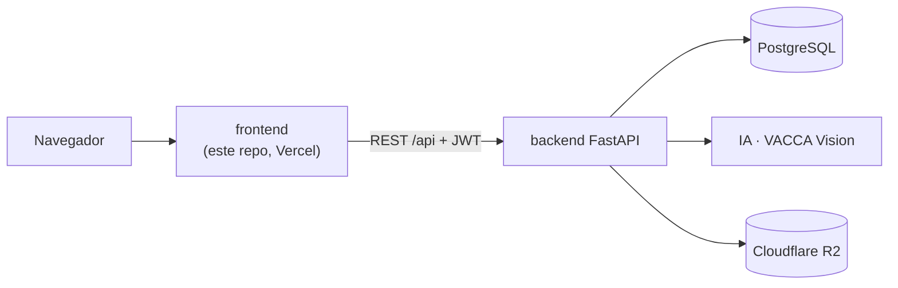

# VACCA · Frontend

Aplicación web de **VACCA**, un sistema de soporte de decisiones para el manejo
nutricional de rodeos de cría. El productor gestiona su rodeo, evalúa la condición
corporal (CC) de cada vaca a mano, con una foto o con un video de la manga, y recibe
tableros, alertas y recomendaciones para la temporada de servicio.

> **Proyecto Final de Ingeniería en Sistemas de Información** · Universidad
> Tecnológica Nacional, Facultad Regional Resistencia (UTN FRRe) · 2026.

📐 **Arquitectura del sistema completo:** [ARQUITECTURA.md](ARQUITECTURA.md)

## Índice

- [Qué hace](#qué-hace)
- [Cómo encaja en VACCA](#cómo-encaja-en-vacca)
- [Stack](#stack)
- [Puesta en marcha](#puesta-en-marcha)
- [Comandos](#comandos)
- [Rutas](#rutas)
- [Estructura de carpetas](#estructura-de-carpetas)
- [Tests](#tests)
- [Despliegue](#despliegue)
- [Documentación adicional](#documentación-adicional)
- [Convención de commits](#convención-de-commits)
- [Flujo de ramas (Git Flow)](#flujo-de-ramas-git-flow)

## Qué hace

- **Rodeo:** alta, edición y baja lógica de animales; búsqueda por caravana y filtros
  por sexo, raza, estado y categoría; carga en tabla de varios animales juntos e
  importación masiva desde CSV/XLSX con revisión previa y archivo de errores.
- **Lotes y mapa:** potreros sobre imagen satelital (Esri World Imagery), importación
  desde KMZ, buscador de localidades y panel lateral con los animales y la CC del lote.
- **Sesiones de evaluación:** carga de CC 1 a 5 por animal, fotos de evidencia validadas
  por IA, CC estimada desde la imagen y análisis de video de la manga por pasaje.
- **Tableros:** del rodeo, de cada animal y de cada sesión (distribución de CC,
  evolución, alertas tipo semáforo).
- **Servicios (temporada de monta):** lotes participantes, estados automáticos según
  fechas, resultados (preñada, vacía, parida), terneros y reservicio de vacas vacías.
- **Recomendaciones de manejo** según CC y categoría, con alerta de pendientes.
- **Trabajo en equipo:** colaboradores por campo e historial de actividad con el
  responsable de cada carga.
- **Landing pública** en `/landing` con la presentación del proyecto y sus etapas.

## Cómo encaja en VACCA



El frontend solo se comunica con la API del backend. Nunca llama directo a IA ni sube
archivos a R2: las imágenes se leen con URLs firmadas que entrega el backend.

## Stack

| Tecnología | Uso |
| --- | --- |
| React 19 + TypeScript | UI |
| Vite 8 | Dev server y build |
| React Router 7 | Ruteo con carga diferida por página |
| Chakra UI 3 | Componentes y tema |
| Recharts | Gráficos de los tableros |
| OpenLayers + JSZip | Mapa de lotes e importación de KMZ |
| React Toastify, Tabler Icons | Avisos e íconos |
| Vitest + Testing Library | Tests unitarios y de componentes |
| Playwright | Tests end-to-end |
| ESLint | Linter |

## Puesta en marcha

Requisitos: Node.js `^20.19.0 || ^22.13.0 || >=24` y pnpm.

```bash
pnpm install
pnpm dev
```

La app queda en `http://localhost:5173`. Para trabajar con datos reales tiene que estar
corriendo el backend (ver su README); el orden completo para levantar todo en local es
PostgreSQL → IA → backend → frontend.

La URL de la API se configura con `VITE_API_BASE_URL`. El `.env` versionado apunta a
`http://localhost:8000/api`; si la variable no está definida, `src/services/httpClient.ts`
usa `http://127.0.0.1:8000/api`.

## Comandos

| Comando | Descripción |
| --- | --- |
| `pnpm dev` | Servidor de desarrollo en `localhost:5173` |
| `pnpm build` | Chequeo de tipos (`tsc -b`) y build de producción en `dist/` |
| `pnpm preview` | Sirve localmente el build de producción |
| `pnpm lint` / `pnpm lint:fix` | ESLint, con o sin correcciones automáticas |
| `pnpm test` | Tests unitarios y de componentes (Vitest) |
| `pnpm test:watch` | Lo mismo, en modo watch |
| `pnpm test:e2e` | End-to-end con Playwright contra el stack real (ver `e2e/README.md`) |
| `pnpm test:video` | Reglas de recuperación del análisis de video |
| `pnpm test:video:browser` | Flujo de video renderizado en navegador, con la API interceptada |

## Rutas

| Ruta | Pantalla |
| --- | --- |
| `/landing` | Landing pública del proyecto |
| `/login`, `/register` | Ingreso y registro |
| `/inicio` | Resumen del campo |
| `/rodeo` | Mapa de lotes y listado de animales |
| `/rodeo/nuevo`, `/rodeo/carga-tabla`, `/rodeo/importar` | Alta individual, carga en tabla e importación masiva |
| `/rodeo/:id` | Ficha del animal con historial, servicios y crías |
| `/sesiones`, `/sesiones/:id`, `/sesiones/:id/cargar` | Sesiones de evaluación, detalle y carga |
| `/servicios`, `/servicios/nuevo`, `/servicios/:id`, `/servicios/:id/reservicio` | Temporadas de servicio |
| `/actividad` | Historial de cargas y responsables |
| `/campo` | Campo y colaboradores |

Las rutas privadas pasan por `ProtectedRoute`. Las rutas viejas `/animales/*` y `/mapa`
redirigen a `/rodeo`.

## Estructura de carpetas

```
src/
├── components/     # Componentes genéricos: layout (sidebar, barra inferior) y ui
├── features/       # Un módulo por dominio, autocontenido
│   ├── auth/       #   Login, sesión y store del usuario
│   ├── animales/   #   Ficha, formularios y tableros de animales
│   ├── rodeo/      #   Pantalla Rodeo (mapa + listado)
│   ├── lotes/      #   Gestión de lotes
│   ├── mapa/       #   Mapa con OpenLayers, capas e importación KMZ
│   ├── sesiones/   #   Sesiones, carga de CC, imágenes y video
│   ├── servicios/  #   Temporada de servicio y resultados
│   ├── recomendaciones/
│   └── landing/    #   Landing pública y etapas del proyecto
├── pages/          # Una página por ruta; solo compone features
├── router/         # Rutas, carga diferida y guardas de sesión
├── services/       # Cliente HTTP base
├── hooks/, lib/, utils/
├── test/           # Configuración de Vitest
├── App.tsx
└── main.tsx
```

Cada feature agrupa sus `components/`, `hooks/`, `services/` (llamadas a la API) y
`types`. Algo sube a las carpetas globales solo cuando lo usa más de un feature.

## Tests

- **Unitarios y de componentes:** Vitest + Testing Library sobre jsdom (`pnpm test`).
- **End-to-end:** Playwright contra frontend, backend y base reales (`pnpm test:e2e`,
  detalles en `e2e/README.md`).
- **Video:** pruebas de reglas en Node y una prueba en navegador con las llamadas a
  `/api/` interceptadas (ver [docs/sesiones-y-video.md](docs/sesiones-y-video.md)).

## Despliegue

Vercel, con build automático desde GitHub. `vercel.json` reescribe todas las rutas a
`index.html` para que funcione el ruteo del lado del cliente. En producción,
`VITE_API_BASE_URL` apunta a la API HTTPS del backend.

## Documentación adicional

- [Arquitectura del sistema](ARQUITECTURA.md): componentes, diagramas y flujos.
- [Sesiones y video](docs/sesiones-y-video.md): ingresos ordenados, análisis de video,
  reintentos y recuperación.
- [Presentación de la landing](docs/LANDING_PRESENTACION.md).

## Convención de commits

```
<tipo>[alcance]: mensaje en imperativo
```

El alcance es opcional (un feature, página o componente). Ejemplos:

```
feat[Auth]: Implementar login con Google
fix[Dashboard]: Corregir dato erróneo en gráfico de ventas
docs[README]: Agregar sección de convención de commits
```

| Tipo | Uso |
| --- | --- |
| `feat` | Nueva funcionalidad |
| `fix` | Corrección de un bug |
| `refactor` | Cambio interno sin nueva funcionalidad |
| `style` | Formato, sin cambios de lógica |
| `docs` | Documentación |
| `test` | Tests |
| `chore` | Mantenimiento, dependencias, configuración |
| `perf` | Rendimiento |
| `ci` | CI/CD |
| `revert` | Reversión |

## Flujo de ramas (Git Flow)

| Rama | Origen | Destino | Uso |
| --- | --- | --- | --- |
| `main` | | | Producción. Solo recibe merges de `release/*` o `hotfix/*` |
| `develop` | | | Integración, base de las features |
| `feature/*` | `develop` | `develop` | Nueva funcionalidad |
| `release/x.x.x` | `develop` | `main` + `develop` | Pruebas finales antes de salir |
| `hotfix/*` | `main` | `main` + `develop` | Corrección urgente en producción |

Nunca se hace commit directo sobre `main` ni `develop`: todo entra por Pull Request con
revisión. Referencia: [Git Flow Cheatsheet](https://danielkummer.github.io/git-flow-cheatsheet/index.es_ES.html).
